# Mojicast マニュアル

配信用リアルタイム字幕アプリ — 画像つき操作ガイド（v1.0.0）

> 配布版には同じ内容の `マニュアル.html`（オフラインで読める単一ファイル版）が同梱されています。
> 画像は `tools/manual/shoot.py` → `build_manual.py` で実画面から自動生成しています。

[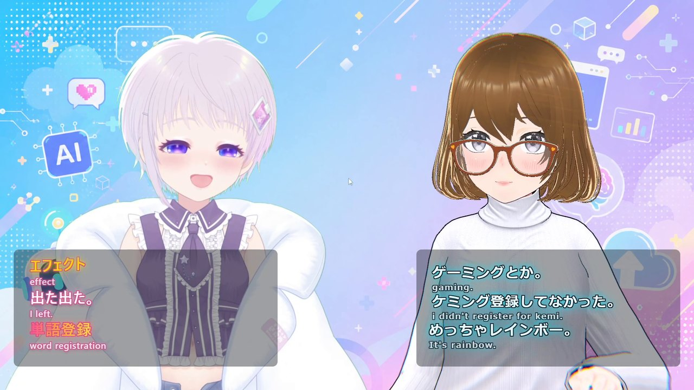](https://youtu.be/GObqilowmkU)

▶ **[30秒デモ動画（YouTube）](https://youtu.be/GObqilowmkU)** — 2人の字幕・翻訳・エフェクトが動く様子
／ テスト協力: [絵咲まくらさん](https://x.com/oftunlab)

## 目次

1. [はじめに](#1-はじめに)
2. [動作環境](#2-動作環境)
3. [コックピット（メイン画面）](#3-コックピットメイン画面)
4. [アプリ設定](#4-アプリ設定)
5. [OBS に字幕を出す](#5-obs-に字幕を出す)
6. [字幕スタジオ（見た目・単語・演出）](#6-字幕スタジオ見た目単語演出)
7. [吹き出し字幕](#7-吹き出し字幕)
8. [翻訳の併記](#8-翻訳の併記)
9. [1対1コラボ字幕](#9-1対1コラボ字幕)
10. [フォルダとアップデート](#10-フォルダとアップデート)
11. [困ったときは](#11-困ったときは)
12. [連絡先・フィードバック](#12-連絡先フィードバック)

### 🔍 逆引き — やりたいことから探す

| やりたいこと | 見る場所 |
|---|---|
| とにかく動かしたい | [1章 はじめに](#1-はじめに) |
| OBS に字幕を出したい | [5章 OBS に字幕を出す](#5-obs-に字幕を出す) |
| **新しい画面が合わない・前の画面に戻したい** | ヘッダーの `旧UI` — [3章](#新ui旧ui) |
| 字幕の見た目を手早く変えたい | 「字幕の見た目」の切替 — [3章 コックピット](#字幕の見た目) |
| 自分だけの字幕デザインを作りたい | [6章 デザインとレイアウトの編集](#デザインとレイアウトの編集) ／ [スタイルガイド](STYLE_GUIDE.md) |
| **漫画みたいな吹き出しで字幕を出したい** | [7章 吹き出し字幕](#7-吹き出し字幕) |
| 「ありがとう」でキラキラを飛ばしたい | ワード演出 — [エフェクトガイド](EFFECT_GUIDE.md) |
| 笑い声や拍手で画像を出したい | [6章 リアクション演出](#-リアクション演出) |
| 名前・ゲーム名が誤認識される | [6章 認識させる単語](#-単語4種類) |
| ゲームの技名などをまとめて登録したい | [6章 単語の一括登録](#単語の一括登録csv--json) |
| ゲームごとに単語を切り替えたい | [6章 単語セット](#単語セット編集する配信で使う) |
| 英語・中国語などの字幕も併記したい | [8章 翻訳の併記](#8-翻訳の併記) |
| 英語＋中国語のように2〜3言語を同時に出したい | [8章 複数の言語を同時に表示](#複数の言語を同時に表示) |
| 言語ごとにフォントや色を変えたい | [6章 翻訳字幕の見た目](#-翻訳字幕) |
| 日本語以外の言語で配信したい | アプリ設定→声の聞き取りで多言語モデルへ（[4章](#-声の聞き取り)） |
| 海外の配信を日本語字幕で見たい | 多言語認識＋翻訳先=日本語（[8章](#8-翻訳の併記)） |
| コラボ相手の字幕も出したい | [9章 1対1コラボ字幕](#9-1対1コラボ字幕)（Windows のみ） |
| 声でレイアウトを切り替えたい | [4章 ボイスコマンド](#-ボイスコマンド) |
| VRChat のチャットボックスに字幕を出したい | [4章 VRChat連携](#-vrchat連携)（Windows のみ） |
| 配信後の文字起こしが欲しい | [10章 字幕ログ](#字幕ログ文字起こし) |
| 設定をバックアップしたい | `data` フォルダをコピーするだけ — [10章](#10-フォルダとアップデート) |
| Zip 版からインストーラ版へ移りたい | [10章 インストーラ版](#インストーラ版windows) |
| 動作が重い | [11章 困ったときは](#11-困ったときは)（認識モデルを「多言語」にすると約1/3に） |
| うまく動かない | [11章 困ったときは](#11-困ったときは) |

---

## 1. はじめに

Mojicast は、マイクの声をその場で文字にして、配信画面に字幕として重ねるアプリです。
音声認識（日本語＋多言語）・句読点付け・翻訳（英・中・日・韓・インドネシア・ポルトガル・スペイン）・コラボ相手の字幕化まで、
**すべてお使いのPCの中だけで動きます**。音声がネットに送られることはありません。

### 配布ファイル

| | ファイル | 始め方 | 向いている人 |
|---|---|---|---|
| **Windows インストーラ版**（おすすめ） | `Mojicast-v*-win-x64-setup.exe` | ダブルクリックしてインストール → スタートメニューの「Mojicast」 | ふつうに使いたい人 |
| Windows Zip 版（ポータブル） | `Mojicast-v*-win-x64.zip` | 展開したフォルダの `Mojicast.exe` | USBメモリで持ち歩きたい・インストールしたくない人 |
| Mac（Apple Silicon） | `Mojicast-*-mac-arm64.dmg` | `Mojicast.app` をアプリケーションフォルダへドラッグ | Mac で配信する人 |

### 起動手順（Windows インストーラ版）

1. `Mojicast-v*-win-x64-setup.exe` をダブルクリック（管理者権限は不要）
2. 画面の案内どおり「次へ」→「インストール」。以前の Zip 版を使っていた人は[10章](#インストーラ版windows)も参照
3. スタートメニューの「Mojicast」で起動

### 起動手順（Windows Zip 版）

1. 展開したフォルダを **丸ごとローカルディスクにコピー** する（Zip の中や共有ドライブから直接起動しない）
2. `Mojicast.exe` をダブルクリック

### 起動手順（Mac）

1. dmg を開き、`Mojicast.app` を **アプリケーション** フォルダへドラッグ
2. 初回だけ macOS の確認を通します。Mojicast は Apple の公証（有料の開発者登録）を受けていないため、
   ダブルクリックすると「“Mojicast” は開いていません」と出ます。**「ゴミ箱に入れる」は押さず「完了」** で閉じてください
3. **システム設定 → プライバシーとセキュリティ** を下へスクロールし、「“Mojicast”の使用がブロックされました」の右の
   **「このまま開く」** → パスワード（または Touch ID）で起動します。2回目からは普通にダブルクリックで起動します
4. 「マイクへのアクセスを許可しますか」と聞かれたら **「許可」**

> dmg 内の「はじめにお読みください（Mac版）」に、画像つきの手順と「壊れているため開けません」と出たときの対処があります。

### 最初の字幕を出すまで

コックピット（メイン画面）の中央に **「はじめの3ステップ」** が出ます。この順に進めれば字幕が出ます。

1. **マイクを選ぶ**（上の 🎤 欄）
2. **「▶ 開始」を押す**（右上のボタン）
3. **表示用のURLをOBSに貼る**（右の「OBSに表示」からコピー → [5章](#5-obs-に字幕を出す)）

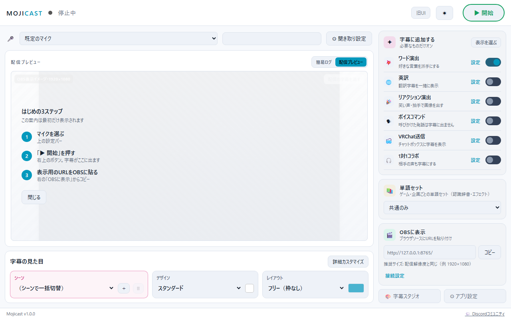

> **初回のみ**
> - Windows で「WindowsによってPCが保護されました」(SmartScreen) が出たら「詳細情報」→「実行」（インストーラ版はインストール時に1回だけ）
> - 初回の ▶開始 で認識モデル（約1.2GB）を自動ダウンロードします。2回目以降は完全オフラインです
> - OSの言語やCPUに合わせた **おすすめ設定** の提案（`💡 おすすめ設定` の帯）が出ることがあります（低スペック機の軽量構成、
>   中国語/英語のOSでの多言語認識など）。`この設定にする` か `今のまま使う` かは自由で、あとからいつでも変えられます

> ⚠ **ご利用にあたって**
> 認識・翻訳・伏せ字は完璧ではなく、不適切な表示が出ることがあります（大事な場面はご自身でも確認を）。
> **1対1コラボは相手の声を字幕化・記録する** ので、相手の同意を得てご利用ください。
> 本アプリは無保証（自己責任）です。詳しい免責は README を参照してください。

## 2. 動作環境

| | Windows | Mac |
|---|---|---|
| OS | Windows 10（2020年以降のアップデート適用）/ Windows 11 | Apple Silicon（M1 以降）の Mac。Intel Mac は非対応 |
| PC | **2017年以降の一般的なPC** なら動きます。新しいほど快適 | Apple Silicon ならどれでも |
| メモリ | 8GB以上（16GB推奨） | 8GB以上（16GB推奨） |
| ストレージ | 空き5GB | 空き5GB |
| その他 | マイク / WebView2ランタイム（Windows 11 は標準搭載） / 初回のみネット接続 | マイク / 初回のみネット接続 |

難しく考えなくて大丈夫です:

- **初回起動時に、あなたのPCに合わせた「おすすめ設定」をアプリが提案します**（適用するかは自由）
- 使ってみて重いと感じたら → [11章 困ったときは](#11-困ったときは)
- 翻訳を **2〜3言語同時** に出す場合は、メモリ16GB以上・余裕のあるCPUがおすすめです（[8章](#複数の言語を同時に表示)）
- ゲーム配信と併用する場合、OBSの映像エンコードは「GPU（NVENC/AMF）」がおすすめ。
  MojicastはGPUをほぼ使わないので、ゲームやOBSと取り合いになりません

> **Mac 版でできないこと**: **1対1コラボ字幕**（相手の声の取り込みが Windows の仕組みに依存するため・将来対応予定）と
> **VRChat連携**（VRChat に Mac 版がないため）は使えません。それ以外の機能は Windows 版と同じです。

CPU世代ごとの詳しい適性表・実測データを知りたい方は **[テクニカルガイド](TECH_GUIDE.md)** へ。

## 3. コックピット（メイン画面）

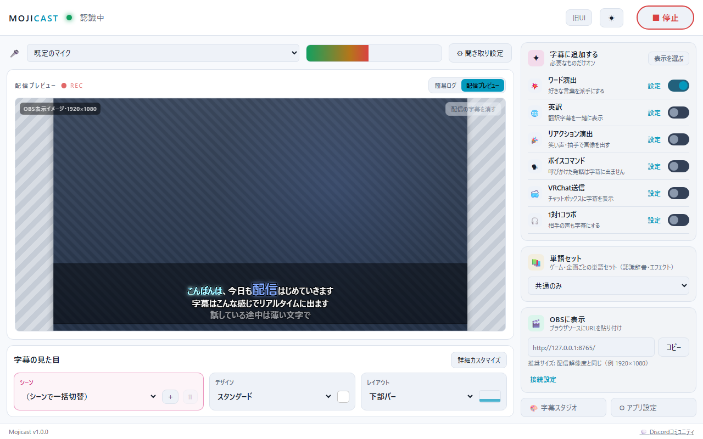

配信中の司令塔です。**左が字幕の確認と見た目の切替、右が字幕に足す機能とOBSへの表示**。
こまかい設定は右下の `🎨 字幕スタジオ` と `⚙ アプリ設定` から開きます。

| 場所 | 内容 |
|---|---|
| ヘッダー | 状態表示（停止中/認識中）・`旧UI`・テーマ切替（🌙/☀）・`▶ 開始`/`■ 停止` |
| マイク欄 | 🎤 マイクの選択・入力レベルのメーター・`⚙ 聞き取り設定`（→[4章](#-声の聞き取り)） |
| 字幕モニタ | 字幕の確認。`簡易ログ`/`配信プレビュー` を切替（下記） |
| 字幕の見た目 | シーン・デザイン・レイアウトの切替 |
| 右カラム | 「字幕に追加する」・「単語セット」・「OBSに表示」 |
| 右下 | `🎨 字幕スタジオ`（[6章](#6-字幕スタジオ見た目単語演出)）・`⚙ アプリ設定`（[4章](#4-アプリ設定)） |
| フッター | バージョン番号・`💬 Discordコミュニティ` |

### 新UI／旧UI

v1.0.0 で画面を全面的に新しくしました。**合わなければ、ヘッダーの `旧UI` でいつでも前の画面に戻せます**
（旧UIの画面にある `新UI` で今の画面に戻ります）。切り替えるとすべての窓が開き直ります。
設定・単語・字幕デザインは両方の画面で共通なので、行き来しても何も失われません。

> 旧UIの字幕スタジオには「吹き出し」の設定項目がありません。吹き出しのレイアウトを作り込むときは新UIで。

### 字幕モニタ（簡易ログ / 配信プレビュー）

モニタ上の切替で表示を選べます。**最初は「配信プレビュー」で開き、前回選んでいた表示を次の起動でも覚えています。**

- **配信プレビュー** … OBSに映る字幕を、1920×1080の画面を縮小してそのまま確認できます。デザインやレイアウトを変えたときの見え方チェックに
- **簡易ログ** … 確定した字幕がテキストで流れる軽い表示。話者や認識内容の確認に

`配信の字幕を消す` で、モニタと **OBSに映っている字幕** の両方を消せます。

### 字幕の見た目

配信前にサッと決める3項目です。じっくり作り込むのは `詳細カスタマイズ`（字幕スタジオ）へ。

| 項目 | 内容 |
|---|---|
| シーン | デザイン＋レイアウトのセットをまとめて切替。`＋` で今の組み合わせを保存、🗑 で削除 |
| デザイン | フォント・色・動き（文字の見た目）の切替 |
| レイアウト | 画面内の表示場所・流れ方の切替。**吹き出し** もここで選べます（[7章](#7-吹き出し字幕)） |

> **シーンの調整と上書き**: シーンを選んだあとデザインやレイアウトを変えると「〇〇（調整中）」表示になり、
> `上書き` でそのシーンを更新、`＋` で別のシーンとして保存できます。
> 「雑談」「ゲーム」「歌枠」の3シーンが最初から入っています。

> 1対1コラボをオンにすると、各行が **「自分」「相手」の2段** になり、別々のデザイン・レイアウトを割り当てられます。

### 字幕に追加する

確定した字幕に「乗せるもの」をスイッチで足します。各行の `設定` から、その機能の詳しい設定画面へ飛べます。

| 機能 | 説明 |
|---|---|
| 💥 ワード演出 | 「ありがとう」などの言葉を光らせたり、パーティクルを飛ばしたりします。**オフでも認識させる単語・伏せ字は効きます**。`設定`→字幕スタジオのワード演出 |
| 🌐 英訳（翻訳） | 確定した字幕の下に翻訳を併記（最大3言語）。名前は1つ目の翻訳先に合わせて変わります（英訳/中国語訳/日本語訳など）。`設定`→アプリ設定の翻訳（[8章](#8-翻訳の併記)） |
| 🎉 リアクション演出 | 笑い声・拍手などを聞き取って、画像やパーティクルを出します（実験的）。`設定`→字幕スタジオのリアクション演出（[6章](#-リアクション演出)） |
| 🗣 ボイスコマンド | 声でレイアウトなどを切り替えます。呼びかけた発話は字幕に出ません。`設定`→アプリ設定のボイスコマンド（[4章](#-ボイスコマンド)） |
| 🥽 VRChat送信 | 字幕をVRChatのチャットボックスへ表示（Windows のみ）。`設定`→アプリ設定のVRChat連携（[4章](#-vrchat連携)） |
| 🎧 1対1コラボ | Discord などの相手の声も字幕にします（Windows のみ）。`設定`→アプリ設定の1対1コラボ（[9章](#9-1対1コラボ字幕)） |

**使わない機能は隠せます。** 見出しの横の `表示を選ぶ` を押すと各行にチェックが出るので、外した機能は一覧から消えます
（機能のオン・オフとは別で、表示だけの設定です。隠した機能も `表示を選ぶ` からいつでも戻せます）。

### 単語セット

**配信で使う単語セット**（認識させる単語・ワード演出の単語などの組み合わせ）を選びます。
「雑談用」「格ゲー用」のように、配信の内容に合わせて切り替えます。単語セットの作り方は[6章](#単語セット編集する配信で使う)へ。

### OBSに表示

表示用URL（`http://localhost:8765`）の `コピー` と、推奨サイズの案内です。`接続設定` でポートを変えられます（[4章 OBS接続](#-obs接続)）。

## 4. アプリ設定

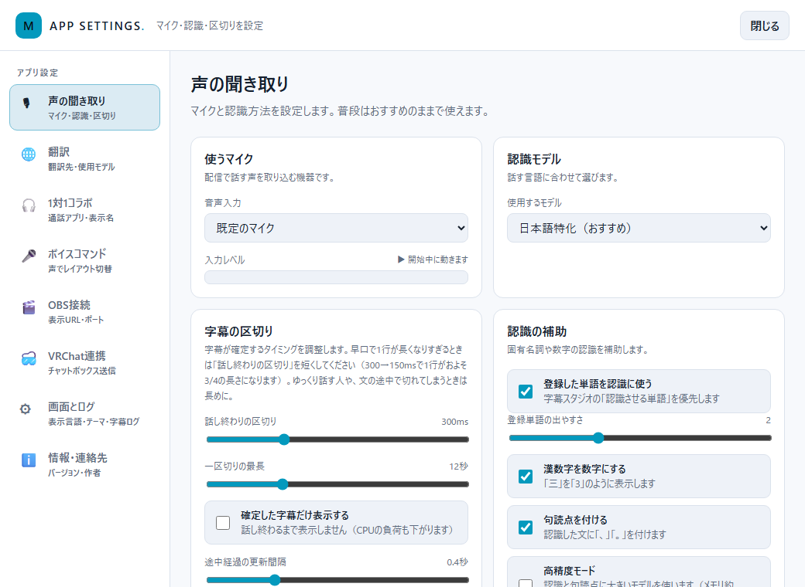

コックピット右下の `⚙ アプリ設定`、マイク欄の `⚙ 聞き取り設定`、「字幕に追加する」の各 `設定` から開きます。
左のメニューで8つに分かれています。**変更はその場で保存されます**（保存ボタンはありません）。

> **反映タイミング**: マイク・認識・翻訳・コラボまわりは **次の ▶開始 から反映** されます。認識中に変えると
> コックピットに `⚠ 変更は次の ▶開始 から反映されます` の帯が出るので、`今すぐ反映（再起動）` を押せばその場で反映できます
> （停止→開始を自動でやるだけです）。

### 🎙 声の聞き取り

| 項目 | 説明 |
|---|---|
| 使うマイク | 音声入力の機器を選びます。**入力レベル** のメーターで、声が届いているか確かめられます（▶開始中に動きます） |
| 認識モデル | **日本語特化（おすすめ）** … 高精度・登録した単語で認識を誘導できる ／ **多言語** … 中・英・日・韓・広東語 |
| 認識する言語 | 多言語モデルのときだけ。自動判定か言語固定（固定のほうが判定ミスがない） |
| 字幕の区切り | `話し終わりの区切り`（この長さ黙ると1行が確定。**早口で1行が長すぎるときは短く**）／`一区切りの最長`（喋り続けたときに強制的に確定する秒数・**重いPCでは短め**）／`確定した字幕だけ表示する`（話し終わるまで何も出さない。**CPUの負荷も下がる**。オンの間はVRChatの入力中表示も出ません）／`途中経過の更新間隔`（薄文字の更新頻度） |
| 認識の補助 | `登録した単語を認識に使う`／`登録単語の出やすさ`（効かない→上げる・誤爆する→下げる）／`漢数字を数字にする`（三十五→35。「一緒」などは変えない）／`句読点を付ける`（確定した文に「、」「。」を付ける）／`高精度モード`（認識と句読点に大きいモデルを使う。メモリ約+650MB・通常はオフでOK） |

> **認識モデルの使い分け**: 通常は「日本語特化」のままでOK。「多言語」の出番は
> ①中国語・英語など日本語以外の配信 ②動作を軽くしたいとき、の2つです。
> 多言語モデルでは「認識させる単語」の認識誘導が効かないため、固有名詞の誤変換は
> 読み欄への登録（置き換え）で直します。日本語の精度は日本語特化のほうが上です。
> 初めて選んだときにモデル（約240MB）を自動ダウンロードします。モデルの中身は[テクニカルガイド](TECH_GUIDE.md)へ。

### 🌐 翻訳

翻訳先の切替と、実際に使われる翻訳モデルの確認です。詳しくは[8章](#8-翻訳の併記)。

- `翻訳字幕を使う`（コックピットの英訳スイッチと連動）
- `字幕を翻訳する言語`: 英語 / 中国語圏（簡体字・中国大陸／繁体字・台湾／繁体字・香港）/ インドネシア語 / ポルトガル語 / スペイン語 / 日本語 / 韓国語〔試験的〕
- `2つ目の翻訳先`・`3つ目の翻訳先`: 同時に表示したい言語を足せます（不要なら「なし」）。別の段で選んでいる言語を選ぶと、その段と入れ替わります
- 選んだ言語ごとに **実際に使われる翻訳モデル**（FuguMT / M2M-100 / ＋OpenCC）が表示されます

### 🎧 1対1コラボ

相手の声の取り込み設定です（Windows のみ）。詳しくは[9章](#9-1対1コラボ字幕)。

- `コラボ字幕を使う`（ヘッドホンを使ってください）
- `相手の声が鳴るアプリ` … Discord.exe などを選ぶ（`↻ 更新`／🔊 ＝いま音が鳴っているアプリ）
- `字幕で使う表示名` の `自分`/`相手`（字幕ログの話者名に使われます）

### 🎤 ボイスコマンド

配信中に **声でMojicastを操作** できます。「ウェイクワード＋コマンド」をひと息に話すと実行され、
**コマンドの発話は字幕に出ません**。実行結果はコックピットの右下に表示されます。

**設定手順:**

1. `ボイスコマンドを使う` をオン（コックピットの「ボイスコマンド」スイッチでも切替可）
2. `ウェイクワード` に呼びかけの名前を登録（例：ステラ）。カタカナ・ひらがなの名前が認識されやすいです。
   違う言葉に化けるときは、**字幕に出たその表記も「、」区切りで並べて登録** してください（例：モジキャスト、文字キャスト）

**組み込みコマンド（「ステラ」をウェイクワードにした例）:**

| 言い方 | 動作 |
|---|---|
| 「ステラ、レイアウトを下部バーに」「ステラ、レイアウト2」 | レイアウト切替（名前、または字幕スタジオの一覧の上から数えた番号） |
| 「ステラ、デザインをサイバーに」「ステラ、デザイン2」 | デザイン切替 |
| 「ステラ、歌枠」「ステラ、シーン2」 | シーン切替（デザイン＋レイアウトを一括） |
| 「ステラ、レイアウト変えて」（デザイン/シーンも同様） | おまかせで別のものに切替 |
| 「ステラ、翻訳を英語に」「ステラ、翻訳オフ」 | 翻訳の切替（**認識の動作中は自動で再起動**） |

**カスタムコマンド:** 自分の言い回しに動作を割り当てられます（例：「おそうじ」→字幕クリア、「うたわく」→歌枠シーン）。
`＋ コマンドを追加` で行を足します。組み込みと同じ言い回しなら、カスタムが優先されます。

> - コマンドは **確定した字幕** から判定するため、発話からひと呼吸おいて実行されます
> - **コラボ中は自分の声だけ** がコマンドとして扱われます（相手の声からは発動しません）
> - ウェイクワードを認識されやすくする効果だけは「■ 停止 → ▶ 開始」後に反映されます（コマンド自体はすぐ使えます）

### 🎬 OBS接続

- `表示用URL`（`コピー`）と推奨サイズの案内
- `接続ポート` … 既定 8765。ほかのアプリとぶつかるときだけ変更（**Mojicastを再起動すると反映**・OBS側のURLも直してください）

### 🥽 VRChat連携

認識した字幕を VRChat の **チャットボックス** に表示できます（Windows のみ）。VRChat 内での会話の補助や
イベント登壇などに。配信（OBS）とは別に使え、**再起動なしですぐ反映** されます。

**設定手順:**

1. VRChat 側で OSC を有効にする: アクションメニュー → Options → OSC → **Enabled**
2. `VRChatへ送信する` をオン（コックピットの「VRChat送信」スイッチでも切替可）
3. `送信内容` で **文字起こし（認識した文章）** か **訳文（翻訳がONのとき）** を選ぶ

> - チャットボックスは **144文字まで**。発話が続くときは VRChat のスパム対策に合わせて **約1.6秒間隔でまとめて送信** されます
> - 発話中はチャットボックスに「入力中」の表示が出ます
> - **コラボ中は自分の発話だけ** が送られます。伏せ字にする単語は伏せ字のまま送られます
> - `OSCポート` は通常変更不要です（VRChat の既定 9000）

### ⚙ 画面とログ

| 項目 | 説明 |
|---|---|
| 字幕ログを保存する | 話した内容をテキストで保存（[10章](#字幕ログ文字起こし)）。`字幕ログの保存フォルダを開く` ボタンあり |
| 表示言語 | アプリの画面の言語（日本語 / 中文 / English） |
| 画面テーマ | ライト（既定）／ダーク。**OBSに映る字幕の色には影響しません** |
| 文字とボタンの大きさ | 自動（画面に合わせる）／小／標準／大／特大。高解像度のモニタで小さく見えるときに |

### ℹ️ 情報・連絡先

今のバージョンの確認、`🔄 更新を確認`、GitHub・Discord・X・クレジット（使っているAIモデルとライセンス）へのリンクです。

## 5. OBS に字幕を出す

1. OBS で「ソース追加」→「**ブラウザ**」
2. URL に `http://localhost:8765`（コックピット右カラムの「OBSに表示」からコピーできます）
3. 幅・高さを **配信の解像度と同じ** に（例: 1920×1080）

話している間は薄い文字で途中経過が出て、ひと呼吸おくと確定した文字に変わり、エフェクトが動きます。
貼る前の見え方は、コックピットの `配信プレビュー` で確認できます。

## 6. 字幕スタジオ（見た目・単語・演出）

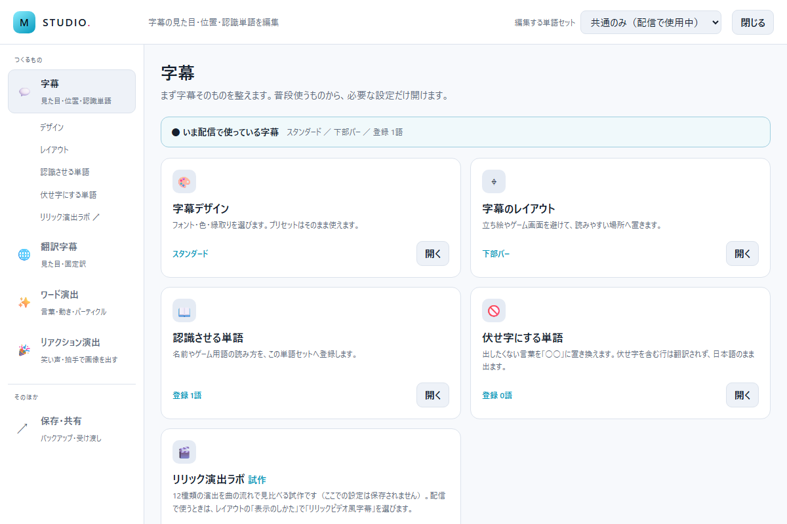

コックピットの `🎨 字幕スタジオ`、`詳細カスタマイズ`、各機能の `設定` から開きます。左のメニューで次の5つに分かれています。

| メニュー | できること |
|---|---|
| 💬 字幕 | 字幕のデザイン・レイアウト、認識させる単語、伏せ字にする単語 |
| 🌐 翻訳字幕 | 翻訳字幕の見た目、訳を固定する単語 |
| ✨ ワード演出 | 言葉に合わせた色・動き・パーティクル |
| 🎉 リアクション演出 | 笑い声・拍手などで画像を出す |
| ↗ 保存・共有 | デザインとレイアウトを `.mojipack` で書き出す・取り込む |

「字幕」を開くと、**いま配信で使っているデザイン・レイアウト・単語セット** が一番上に出ます。

> **保存していない変更の確認**: デザイン・レイアウト・単語は **保存ボタンを押すと配信に反映** されます。
> 保存していない変更があるあいだは `● 未保存の変更があります` と表示され、そのまま字幕スタジオを閉じたり
> 単語セットを切り替えたりしようとすると **「保存して続ける／保存しない／戻る」** を聞かれます。

### デザインとレイアウトの編集

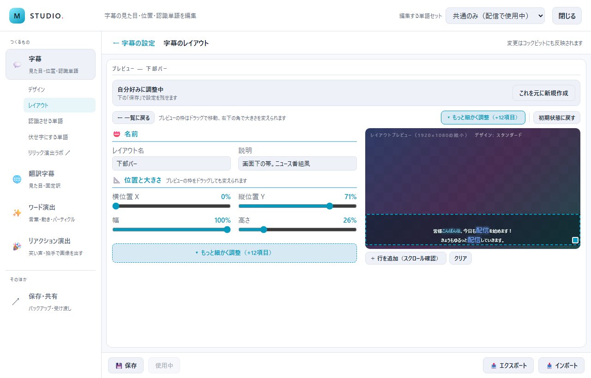

1. 「字幕」→ 字幕デザイン（または字幕のレイアウト）の `開く`
2. 一覧から選ぶと、プレビューで見え方を確認できます。気に入ったら `このデザインに切り替える`（`このレイアウトに切り替える`）で配信に使います
3. 自分好みに直すときは `カスタマイズ`。同梱のものを直接いじらず、`これを元に新規作成` で自分用を作るのがおすすめです
4. **編集中は設定の欄とプレビューが横に並び**、いじった結果をすぐ確かめられます。最初はよく使う項目だけ出ています。
   全部の項目を出すときは `もっと細かく調整`（`基本項目だけに戻す` で戻ります）。項目は「名前」「本文」「位置と大きさ」などの見出しで区切られています
5. **レイアウトは、プレビューの枠をドラッグで移動、右下の角で大きさを変えられます**
6. `💾 保存` で配信に反映。同梱の状態に戻したいときは `初期状態に戻す`

| デザインでできること | レイアウトでできること |
|---|---|
| フォント・太さ・サイズ・文字色・強調の色・縁取り・グロー・影・字間・登場アニメ、途中表示（薄文字）の濃さ、翻訳字幕の見た目 | 位置と大きさ、`表示のしかた`（**通常（積み上げ・スクロール）／縦書き（右から左へ）／リリックビデオ風字幕／吹き出し（漫画風）**）、文字揃え、保持する行数・スクロール・一定時間で消す、枠の背景・枠線・角丸・余白 |

- コラボ用に「コラボ（小さめ）」デザインと「左下ハーフ」「右下ハーフ」レイアウト、吹き出し用に「吹き出し」「吹き出し（縦書き）」レイアウトが最初から入っています
- 各項目の意味や読みやすくするコツは **[スタイル・レイアウト作成ガイド](STYLE_GUIDE.md)** にまとめています
- 「字幕」の **リリック演出ラボ**（試作）では、12種類のリリック演出を曲の流れで見比べられます（ここでの設定は保存されません）

### 📖 単語（4種類）

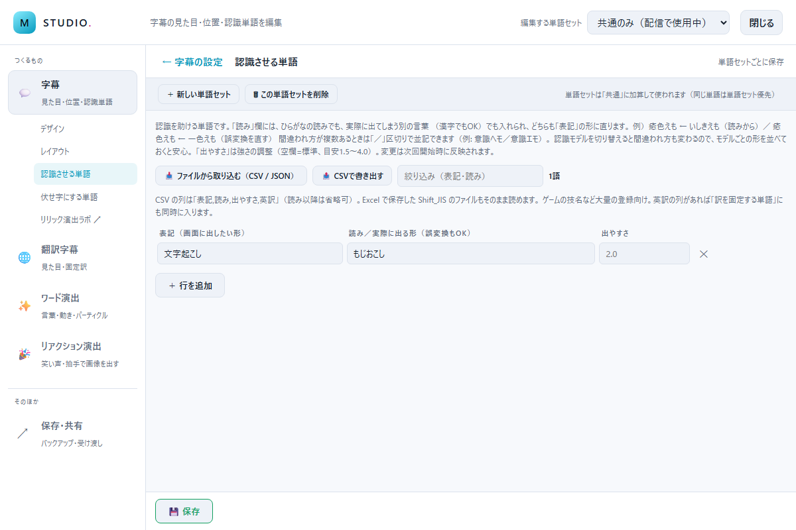

| 種類 | 役割 |
|---|---|
| 🎤 認識させる単語 | 名前やゲーム用語の誤認識対策。「読み／実際に出る形」欄には、ひらがなの読みでも **実際に出てしまう誤変換の形** でも入れられ、どちらも「表記」の形に直ります。**「／」区切りで複数並べられます**（「,」で区切っても「／」に直して保存します）。`出やすさ` は空欄=標準、目安1.5〜4.0。**次の ▶開始 から反映** |
| ✨ ワード演出の単語 | 画面に出たときに派手に飾る単語。色・フォント・サイズ・アニメ・飛ぶ絵文字を個別に指定。**保存するとすぐ反映** |
| 🚫 伏せ字にする単語 | 出したくない言葉を「○○」に置き換えます（途中経過・確定字幕・ログのすべて）。**伏せ字を含む行は翻訳されず、日本語のまま出ます**（訳すと伏せ字が別の語に化けるため）。次の ▶開始 から反映 |
| 🌐 訳を固定する単語 | 名前や作品名を、いつも同じ表記で訳します（例: 星野ひかり → Hikari Hoshino）。**大文字で始めた英訳は中国語・韓国語などの翻訳にも使われ**、その言語の読みに置き換わって残ります。小文字で始めた語（例: 文字起こし → transcription）は英訳だけ。次の ▶開始 から反映 |

強調エフェクトの全カタログ（アニメ13種・パーティクル6種）と演出のコツは **[エフェクトガイド](EFFECT_GUIDE.md)** にまとめています。

#### 単語セット（編集する／配信で使う）

**単語セット** は「雑談用」「格ゲー用」のような単語の組み合わせです。単語セットは「共通」に **加算** して使われます
（同じ単語は単語セット側が優先）。いつも使う単語は「共通のみ」に入れておけば、全部の単語セットで効きます。

- **配信で使う単語セット** はコックピットの「単語セット」で選びます
- **編集する単語セット** は字幕スタジオ右上で選びます。ここで別の単語セットを開いて直しても、**配信中の認識は変わりません**
- 配信で使っていない単語セットを開いているときは、右上に「配信では『〇〇』を使用中」と出ます。
  `配信でこのセットを使う` を押すと、その単語セットに切り替わります
- 単語セットの作成・削除は、単語の画面の上の `＋ 新しい単語セット`／`🗑 この単語セットを削除` から

#### 単語の一括登録（CSV / JSON）

ゲームの技名のように **数百〜数千語** をまとめて入れたいときは、🎤 認識させる単語の
`📥 ファイルから取り込む（CSV / JSON）` を使います。1語ずつ入力する必要はありません。

- 列は `表記,読み,出やすさ,英訳,種別`（読み以降は省略可・`#` で始まる行はコメント）。雛形: [words_template.csv](words_template.csv)
- **英訳の列があれば「訳を固定する単語」にも同時に入ります**（技名の公式英語名など）
- Excel で保存した CSV（Shift_JIS）もそのまま読めます。JSON は `{"words":[{"surface","reading","score","en"}]}`
- 取り込む前に件数・既にある語・ファイル内の重複・弾いた行が表示され、**「追加のみ」か「同じ表記は上書き」** を選べます
- `📤 CSVで書き出す` で今の単語セットを同じ形式で `data/export/` に書き出せます（Excel で編集して戻す・バックアップ・雛形に）。
  書き出したCSVを取り込み直しても、英訳だけの語が認識の単語に混ざることはありません
- 🌐 訳を固定する単語でも、同じように取り込み・書き出しができます（列は `日本語,英訳` の2列、JSON は `{"glossary":[{"ja","en"}]}`）

読みを付けるのが大変なときは、AI（ChatGPT など）に作らせるのが早いです。プロンプト例:

> ◯◯（ゲーム名）の全キャラクターの技名を CSV で列挙して。列は「表記,読み,出やすさ,英訳」で、
> 読みはひらがな、出やすさは空欄、英訳は公式英語名。1行目は見出し行にして。

AI の出力には実在しない語や間違った英名が混ざることがあるので、取り込み前の集計を見て確認してください。

### 🌐 翻訳字幕

- `翻訳字幕の見た目` … 翻訳字幕のサイズ（本文比）・濃さ・専用の色・フォント・縁取り/グローを、本文と別に設定できます。使用中のデザインに含まれる設定です
- `見た目を設定する言語` … 「すべての言語（共通）」のほかに言語を選び、`この言語だけ別の見た目にする` をオンにすると、
  **その言語だけ** サイズ・色・フォント・縁取りを変えられます。中国語・韓国語は **文字が入っていないフォント** もあるので、
  言語ごとにフォントを選べるのが一番の使いどころです。プレビューにはその言語の例文が出ます
- `表示モード` … **日本語と併記（標準）／翻訳のみ表示**（[8章](#8-翻訳の併記)）
- `訳を固定する単語` … 上の「🌐 訳を固定する単語」と同じものです
- `翻訳の動作設定 ↗` … 翻訳先の切替（アプリ設定の翻訳へ）

### 🎉 リアクション演出

笑い声・拍手・歓声などを **マイクの音から聞き取って**、画像やパーティクルを画面に出す機能です（実験的）。

1. 字幕スタジオの「リアクション演出」（またはコックピットの「リアクション演出」の `設定`）を開き、`リアクション演出を使う` をオン
2. 初回だけ検出モデル（約27MB）を取得します。**次の ▶開始 から動きます**
3. 演出したい音（笑い・拍手・歓声・歌・口笛・泣き・驚き・叫び・咳・くしゃみ など）ごとに `有効にする` をオンにし、`＋ 画像を追加…` で画像（GIFも可）を選ぶ
4. 画像はプレビュー上でドラッグして配置、クリックで選んで大きさを変えられます。パーティクル・登場の動き・表示時間・`音の大きさ（スコア）で演出を強くする` なども選べます
5. `🎉 テスト発火` で、声を出さずに見え方を確認できます

> 検出のしやすさには、声質や笑い方の個人差があります。

### ↗ 保存・共有（mojipack）

- `カスタマイズを書き出す` … デザインとレイアウトを `.mojipack` ファイルにまとめます（`ファイルに保存`／`保存先を開く`）
- `もらったカスタマイズを使う` … 受け取った `.mojipack` を追加します（**今ある設定は上書きされません**）

デザイン・レイアウトの編集画面の下（`📤 エクスポート`／`📥 インポート`）からも同じ操作ができます。
配り方・もらい方のコツは[スタイルガイド 7章](STYLE_GUIDE.md#7-書き出し取り込みmojipack-みんなで使おう)へ。

## 7. 吹き出し字幕

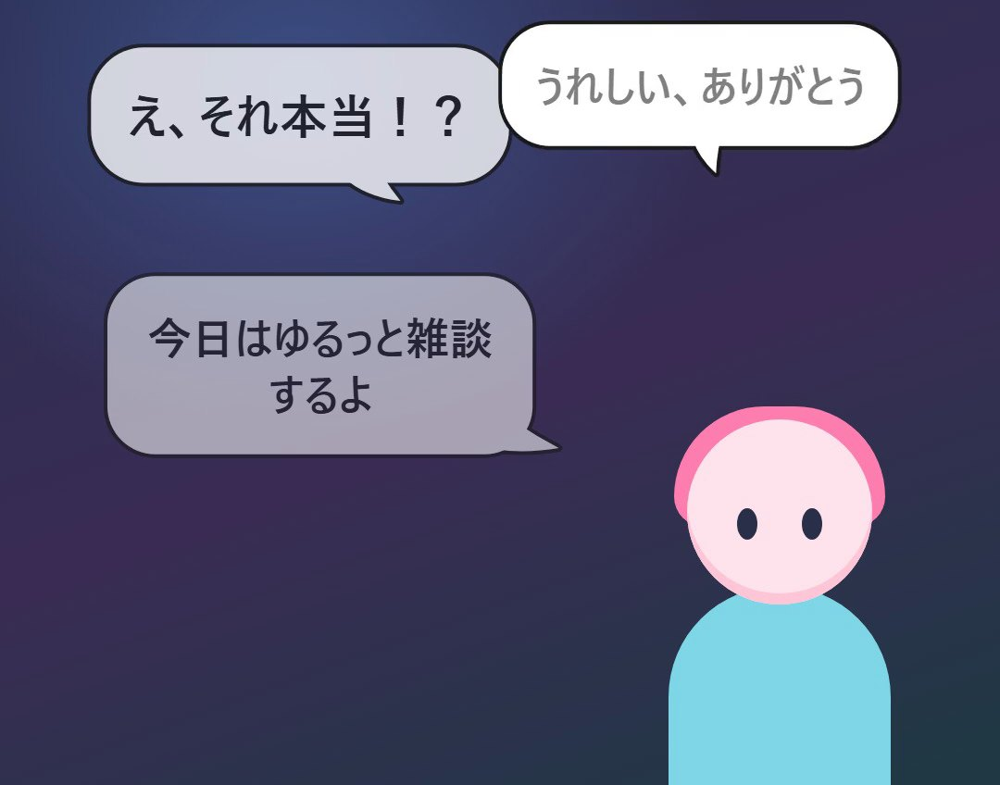

話した内容を **漫画の吹き出し** で出すレイアウトです（v1.0.0〜）。**吹き出しの尻尾がアバターの方を向きます。**
文の長さで吹き出しが伸び縮みし、話している途中は薄い文字で伸びていきます（上の例の右上）。

### 使い方

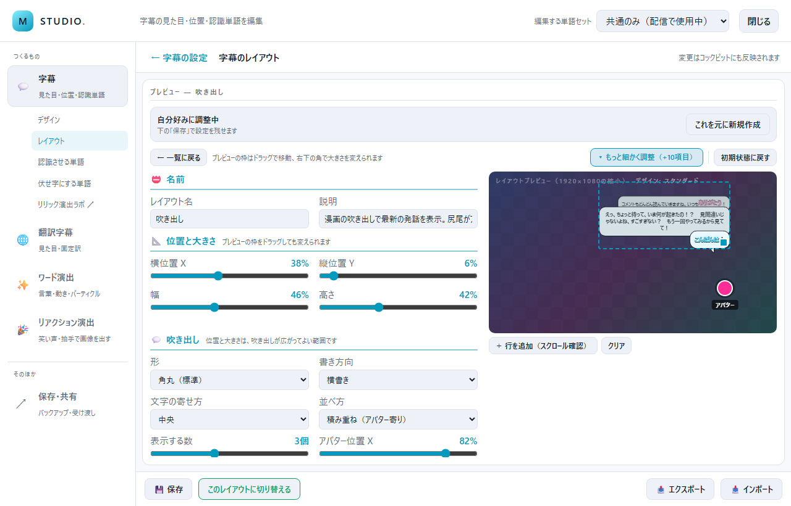

1. コックピットの「字幕の見た目」→ **レイアウト** で、同梱の **「吹き出し」** か **「吹き出し（縦書き）」** を選ぶ。これだけで使えます
2. アバターの位置に合わせるときは、字幕スタジオ → 字幕のレイアウト → 吹き出しのレイアウトを選んで `カスタマイズ`
3. プレビューの **「アバター」の印をドラッグ** して、配信画面のアバターの位置に重ねる（尻尾がその方向を向きます）
4. プレビューの枠（吹き出しが広がってよい範囲）を、ドラッグと右下の角で調整して `💾 保存`

自分で作るときは、レイアウトの `表示のしかた` を **吹き出し（漫画風）** にすると、「💬 吹き出し」の項目が出ます。

### 吹き出しの項目

| 項目 | 内容 |
|---|---|
| 形 | **角丸（標準）／楕円／ギザギザ（叫び）／もくもく（考え中）** |
| 書き方向 | 横書き／縦書き |
| 文字の寄せ方 | 横書きは左詰め・中央・右詰め、縦書きは上詰め・中央・下詰め |
| 表示する数 | 何個前の発話まで吹き出しを残すか（1〜6個）。新しいものほど手前に出ます |
| 並べ方 | **積み重ね（アバター寄り）** … 新しいものほど手前、古いものは少し小さく奥へ ／ **ポイントに散らす** … プレビューで置いた場所のうち、ほかと重ならない所にランダムで出し、古いものほど薄くなります |
| アバター位置 X / Y | 尻尾が向く先（プレビューの「アバター」の印のドラッグと同じ） |
| 尻尾をアバターへ向ける・尻尾の長さ | 尻尾の有無と長さ（既定 30px） |
| 文字の大きさ・縮めてよい下限 | 文の長さで吹き出しが伸び縮みし、入りきらないときは下限まで文字を縮めます |
| 塗りの色・濃さ、線の色・太さ | 吹き出しの見た目 |
| 吹き出し用の文字色にする | オンにすると、デザインの色・縁取りを使わず、吹き出しに読みやすい文字色で出します |
| 認識途中も表示する | 話している途中も、薄い文字で吹き出しが伸びていきます |
| 消えるまでの時間 | 0 で次の発話まで残ります |

**ポイントに散らす** ときは、プレビューの空いている所を **クリックでポイントを追加、ドラッグで移動、ダブルクリックで削除**（最大8か所）。
`1つの大きさの上限 幅／高さ` で、1つの吹き出しが広がる大きさを決めます。

> **コラボで使うとき**: 自分も相手も同じ吹き出しレイアウトを選ぶと、**2人の吹き出しを1つにまとめて**、重ならないように並べます。
> 相手の吹き出しの尻尾は **「相手のアバター位置」**（プレビューの「相手」の印）を向きます。この項目はコラボがオンのときだけ出ます。

## 8. 翻訳の併記

コックピットの **「英訳（翻訳）」をオン** にすると、確定した字幕の下に翻訳が併記されます。
翻訳先は「アプリ設定 → 翻訳」で切り替えます（コックピットの名前も翻訳先に合わせて変わります）。

| 翻訳先 | 使用モデル | 補足 |
|---|---|---|
| 英語（既定） | FuguMT | 「配信→stream」「スパチャ→Super Chat」など配信用語の組み込み辞書つき |
| 中国語（簡体字・中国大陸） | M2M-100 | 「配信→直播」など配信用語に対応。初めて選んだときに翻訳モデルを自動ダウンロード（約470MB） |
| 中国語（繁体字・台湾） | M2M-100 ＋ OpenCC | 簡体字の訳を、台湾の正体字と台湾で一般的な語彙へ整えます |
| 中国語（繁体字・香港） | M2M-100 ＋ OpenCC | 簡体字の訳を香港の繁体字へ整えます |
| インドネシア語 | M2M-100 | 日本語から直接翻訳します |
| ポルトガル語 | M2M-100 | 日本語から直接翻訳します。「配信→transmissão ao vivo」など配信用語に対応 |
| スペイン語 | M2M-100 | 日本語から直接翻訳します。「配信→transmisión en vivo」など配信用語に対応 |
| 日本語 | M2M-100 | 多言語認識（中・英・韓）と組み合わせて、**海外の配信を日本語字幕に** する使い方 |
| 韓国語 | M2M-100 | **試験的**。翻訳が不安定なことがあります |

- 名前などは、字幕スタジオの「訳を固定する単語」で訳を固定できます（大文字で始めた英訳は、ほかの言語の翻訳にも使われます）
- 広東語は繁体字の種類ではなく別の言語です。現在は音声認識のみ対応で、翻訳先には選べません
- 認識している言語と同じ翻訳先を選ぶと、翻訳はスキップされます
- 翻訳もPCの中で動きます（ネット不要・初回のダウンロードのみ）。どの翻訳AIがどう選ばれるかは[テクニカルガイド](TECH_GUIDE.md)へ

> **翻訳のみ表示**: 字幕スタジオ「翻訳字幕の見た目」の `表示モード` を **翻訳のみ表示** にすると、
> 日本語を出さずに訳文だけを **本文のサイズ・エフェクト** で表示できます（画面の圧迫を防げます）。
> デザインごとの設定なので、シーンに組み込めば「ステラ、英語配信」のようにボイスコマンドで一括切替もできます。
> 翻訳がオフのときは自動で日本語の表示に戻ります。強調する単語のエフェクトは、訳文に出る **英語の表記**（例: Stella）で
> 登録すると翻訳のみ表示でも発動します（訳を固定する単語との併用が確実です）。

### 複数の言語を同時に表示

「アプリ設定 → 翻訳」の `2つ目の翻訳先`・`3つ目の翻訳先` で、**最大3言語** を同時に出せます（例: 英語＋中国語＋ポルトガル語）。

- 字幕には **選んだ順に縦に並びます**（届いた順ではありません）
- **翻訳のみ表示** では、1つ目の言語が本文になり、2つ目以降はその下に訳文の書式で付きます
- 訳の速い言語から先に出ます。英語はほぼすぐ、ほかの言語は0.2〜0.4秒ほど遅れて追いつきます
- ある言語だけ訳せなかった行は、その言語だけ表示しません（ほかの言語は出ます）
- **VRChat** のチャットボックスには1つ目の言語だけ送ります（チャットボックスは1枠のため）
- ボイスコマンドの「翻訳を韓国語に」は、韓国語を **1つ目に繰り上げ** ます（ほかの言語は残ります）
- 言語ごとの見た目は[6章 翻訳字幕](#-翻訳字幕)で変えられます

> **重さの目安**: 翻訳は1言語ずつ順に行うので、言語を足すほど CPU の負荷が増えます。
> メモリは「英語」と「それ以外の言語」で別のAIを使うため、**英語＋中国語のように両方を使うと約1GB**、
> 中国語＋ポルトガル語のように英語以外どうしなら1言語のときとほぼ同じです。
> 中国語の簡体字・台湾・香港を並べても、翻訳は1回で済むのでほとんど重くなりません。重いときは言語を減らしてください。

> **訳の精度について**: 翻訳はPCの中で完結する **軽いローカルモデル** で動くため、精度はクラウド翻訳ほどではなく
> **「意味が伝わればOK」くらいのそれなり** とお考えください。長い一文や固有名詞・スラングは崩れやすく、
> ときどき意味が逆になることもあります（「全然大丈夫じゃない」が「大丈夫」と訳されるなど）。大事な場面では頼りすぎないでください。
> 気になった誤訳はぜひフィードバックを。

## 9. 1対1コラボ字幕

Discord などで通話しながらのコラボ配信で、**自分と相手の両方の字幕** を別々のデザイン・位置で
表示できます（Windows のみ）。相手の声は「通話アプリの音」から直接取り込むので、**相手側の準備は一切不要** です
（相手がスマホ・ゲーム機でもOK）。

▶ 実際に動く様子は **[30秒デモ動画（YouTube）](https://youtu.be/GObqilowmkU)** をどうぞ。

| できること | 制約 |
|---|---|
| 相手はアプリの導入・設定不要 | **1対1限定**（3人以上だと相手全員の声が1つにまとまる） |
| 相手の字幕に専用のデザイン・位置を割り当て | 相手の音は通話の音質なので、精度は自分よりやや低め |
| 字幕ログに話者名が付く | Windows 10 2004 以降が必要（Mac は非対応） |

### 設定手順

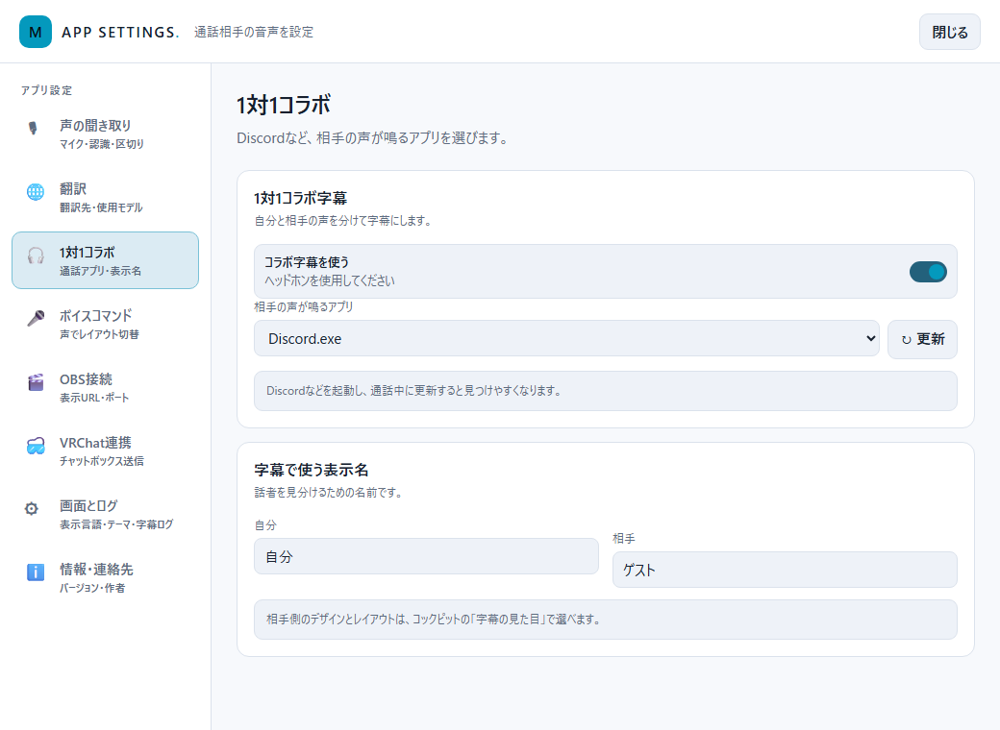

1. コックピットの **「1対1コラボ」をオン** → アプリ設定の「1対1コラボ」が開きます
2. Discord などを起動してから **↻ 更新** を押し、「相手の声が鳴るアプリ」で **Discord.exe** などを選ぶ（🔊 = いま音が鳴っているアプリ）
3. 自分と相手の **表示名** を決める
4. コックピットの「字幕の見た目」が **自分/相手の2段** になるので、相手の **デザイン・レイアウト** を選ぶ。
   おすすめは 自分=**右下ハーフ** / 相手=**左下ハーフ**。2人とも **吹き出し** にすると、吹き出しを1つの画面にまとめて並べます（[7章](#7-吹き出し字幕)）
5. **ヘッドホンを着けて** ▶開始

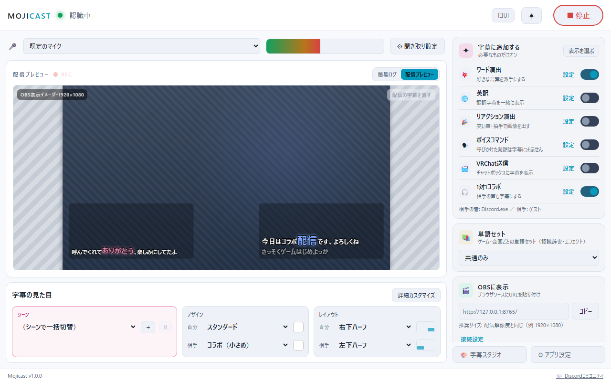

> ⚠ **ヘッドホン必須**: スピーカーで聞くと、相手の声をマイクが拾って二重に字幕になります。
>
> **負荷**: コラボ中は認識が2人分になるため、PCによっては重くなります。
> 重い場合は認識モデルを「多言語」にするのが効果的です（**2人分でも負荷がほぼ増えません**。精度は少し下がります）。
> 詳しい実測データは[テクニカルガイド](TECH_GUIDE.md)へ。

## 10. フォルダとアップデート

| 場所 | 内容 |
|---|---|
| `Mojicast.exe`（Mac は `Mojicast.app`） | アプリ本体 |
| `models` | AIモデル（初回に自動ダウンロード） |
| `data` | 設定・単語・字幕デザイン一式。**バックアップはこのフォルダのコピーだけ** |
| `data\profiles` | 単語セット |
| `logs` | 字幕ログ（文字起こし）と診断ログ |

- **Windows Zip 版**: 展開したフォルダの中にあります
- **Windows インストーラ版**: `%LOCALAPPDATA%\Programs\Mojicast` の中。スタートメニューの **「Mojicast のフォルダを開く」** から開けます
- **Mac**: `~/ライブラリ/Application Support/Mojicast` の中（`Mojicast.app` の中ではありません）

### 字幕ログ（文字起こし）

アプリ設定の「画面とログ → 字幕ログを保存する」がオンのとき（既定オン）、配信の文字起こしがテキストで残ります。

- 保存先は `logs\日付\`。**▶開始のたびに1ファイル**（例: `logs\2026-07-20\2026-07-20_161916.log`）
- 各行は `[発言時刻] 本文`。**コラボ中は `[話者名]` も付く** ので誰の発言か分かります
- 確定した字幕だけを記録します（途中経過の薄文字は残りません）。伏せ字は伏せ字のまま
- 発言ごとに書き込むため、アプリが落ちてもそれまでの分は残ります
- 自動では削除されません。古い日付のフォルダはそのまま削除してOKです
- 使い道: アーカイブ字幕づくり・切り抜きの台本探し・過去の発言の全文検索

### 更新のお知らせ

新しいバージョンが出ると、コックピットの上に「新しいバージョンがあります」の帯が出ます。
アプリ設定 →「情報・連絡先」→ `🔄 更新を確認` からいつでも確かめられます
（確認・ダウンロードのページはブラウザで開きます。音声やデータが送信されることはありません）。

### インストーラ版（Windows）

- インストール先は既定で `%LOCALAPPDATA%\Programs\Mojicast`（ユーザーごと・管理者権限不要）
- **アップデート**: 新しい `setup.exe` を実行するだけ。設定・単語・AIモデルはそのまま残ります
- **アンインストール**: Windows の「設定 → アプリ → Mojicast」。最後に「設定やAIモデルも削除しますか？」と
  聞かれます（「いいえ」で残せます。入れ直せばそのまま使えます）

**以前の Zip 版から移るとき（設定の引き継ぎ）:**

- インストール先の画面で、**今使っている Mojicast のフォルダ（`Mojicast.exe` があるフォルダ）を選ぶ** と、
  プログラムだけ入れ替わり、字幕デザイン・単語・設定・AIモデルをそのまま使えます
- 別の場所（既定の場所）にインストールした場合は、**初めて起動したときにコックピットの上に
  「以前の Mojicast から引き継ぐ」案内** が出ます。デスクトップ・ダウンロード・ドキュメントにある
  Mojicast を探して候補に出すので、選んで「引き継ぐ」を押すだけです（見つからなければ「別のフォルダを選ぶ…」）
- AIモデルもコピーするか選べます（コピーすれば再ダウンロード不要）。引き継ぎ元のフォルダは変更しません
- 使っていなかった人は「使っていない」で案内を閉じれば、以後は出ません

### Zip 版のアップデート（Windows）

Mojicast を終了 → 古い `_internal` フォルダを削除 → 新しい Zip を同じフォルダに上書き展開。
`data` と `models` は引き継がれます。新しく追加された同梱のデザイン・レイアウトは、初回起動時に自動で一覧へ追加されます。
アンインストールはフォルダを削除するだけです（レジストリは使いません）。

### Mac のアップデート

新しい dmg の `Mojicast.app` を、アプリケーションフォルダへドラッグして上書きします。
設定・単語・AIモデルは `~/ライブラリ/Application Support/Mojicast` にあるので、そのまま残ります。
アンインストールは `Mojicast.app` をゴミ箱へ（データも消すときは上のフォルダも削除）。

## 11. 困ったときは

| 症状 | 対処 |
|---|---|
| 新しい画面が使いにくい | ヘッダーの `旧UI` で前の画面に戻せます（[3章](#新ui旧ui)）。設定や単語はそのまま使えます |
| 動作が重い | ① 認識モデルを「多言語」に（負荷が約1/3・精度は少し下がる。アプリ設定→声の聞き取り→認識モデル） ②「高精度モード」をオフ ③ 翻訳をオフ、または翻訳先を1言語に減らす ④「一区切りの最長」を8秒に ⑤「確定した字幕だけ表示する」をオン（途中経過の計算を省く）。詳しくは[テクニカルガイド](TECH_GUIDE.md) |
| 2つ目・3つ目の翻訳が遅れて出る | 翻訳は1言語ずつ順に行うため、後の言語ほど遅れます（1文あたり0.1〜0.2秒ずつ）。遅れが積み重なるようなら言語を減らしてください |
| 中国語・韓国語の訳が□や変な字形になる | 選んだフォントにその言語の文字が入っていません。字幕スタジオ→翻訳字幕の見た目の `見た目を設定する言語` で、その言語だけ別のフォントにできます |
| 吹き出しの尻尾が変な方向を向く | 字幕スタジオでレイアウトを `カスタマイズ` し、プレビューの「アバター」の印をアバターの位置へドラッグ（[7章](#7-吹き出し字幕)） |
| 保存したのに配信に反映されない | 認識させる単語・伏せ字・訳を固定する単語は **次の ▶開始 から** 反映されます（コックピットの `今すぐ反映（再起動）` も使えます）。編集している単語セットが「配信で使う単語セット」と同じかも確認を（[6章](#単語セット編集する配信で使う)） |
| コックピットに一部の機能が見当たらない | 「字幕に追加する」の `表示を選ぶ` で隠しているかもしれません。チェックを入れ直すと戻ります |
| 画面が真っ白（Windows） | Microsoft Edge WebView2 ランタイムをインストール（Windows 11 では通常起きません） |
| 「ポート使用中」と出る | 二重起動を解消。ほかのアプリとぶつかるなら「アプリ設定→OBS接続→接続ポート」で変更 |
| マイクを拾わない | アプリ設定→声の聞き取りの入力レベルのメーターで確認。Windows は「設定→プライバシー→マイク」、Mac は「システム設定→プライバシーとセキュリティ→マイク」で Mojicast を許可。ほかのアプリがマイクを占有していないかも確認を |
| コラボで相手の字幕が出ない | 通話アプリを起動してから ↻ 更新 → 選び直し → ■停止→▶開始 |
| コラボで字幕が二重に出る | ヘッドホンを使う |
| OBSに出ない | URL・▶開始しているかを確認し、ブラウザソースを右クリック→「再読み込み」 |
| 「句読点/翻訳の読み込みに失敗」と出る | 字幕本体は動きます。原因が `logs\load_error.log` に残るので、報告のときに添えてください |
| 多言語モデルで固有名詞が直らない | 認識誘導が効かないモデルのため、「認識させる単語」の読み欄に **実際に出た誤変換の形** を登録（「／」区切りで複数OK） |
| 翻訳が出ない | 認識している言語と翻訳先が同じだとスキップされます。アプリ設定→翻訳の「使用モデル」の表示を確認 |
| 起動しない（Windows Zip 版） | ローカルディスクに置き、フォルダ内の `ブロック解除.bat` を実行。インストーラ版ではこの問題は起きません |
| Mac で「開いていません」「壊れているため開けません」と出る | [1章 起動手順（Mac）](#起動手順mac) と、dmg 内の「はじめにお読みください（Mac版）」を参照 |
| ログや設定のフォルダが見つからない | [10章](#10-フォルダとアップデート)の場所を参照（インストーラ版はスタートメニューの「Mojicast のフォルダを開く」） |

上級者向け: 認識中に `http://localhost:8765/api/perf` を開くと、認識処理の回数・平均所要時間(ms)を確認できます。

## 12. 連絡先・フィードバック

使ってくれてありがとうございます！ 不具合報告・要望・感想はお気軽にどうぞ。
報告の際は、アプリ設定の「情報・連絡先」に表示される **バージョン番号** もあわせてお知らせください。

| 窓口 | 用途 |
|---|---|
| 💬 [Discord コミュニティ](https://discord.gg/Qmx7Mrf6TE) | 使い方の質問・要望・雑談 |
| 🐙 [GitHub Issues](https://github.com/ishiki-emo/mojicast/issues) | 不具合報告・機能要望 |
| 𝕏 [X @ishiki_emo](https://x.com/ishiki_emo) | 作者（癒色えも）へ直接ひとこと |

アプリ内でも、コックピットのフッターの `💬 Discordコミュニティ` や、アプリ設定 → 情報・連絡先 から開けます。

特に助かる情報:
- 誤認識・誤訳の具体例（何と言ったら何と表示されたか）
- 落ちた・固まったときの直前の操作
- お使いのPCのスペック（CPU・メモリ）と動作の軽さ・重さの体感
- `logs\load_error.log` が出ていればその内容
